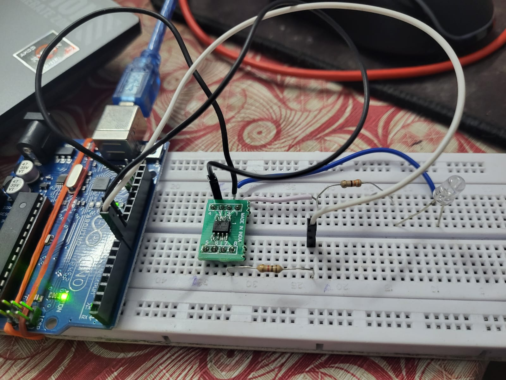

# CH32V003 RISC-V Bare-Metal Firmware

**Bare-metal embedded firmware development on the WCH CH32V003J4M6 using Embedded C, direct register programming, and an Arduino Uno-based SWIO programmer.**

This project explores low-level microcontroller programming using the RISC-V-based CH32V003. The development workflow was carried out on **Linux Mint**, using open-source tools and a repurposed Arduino Uno as the firmware programming interface.

The primary objective is to understand the microcontroller at the register level, develop firmware without relying on a Hardware Abstraction Layer (HAL), and establish a practical, low-cost embedded development environment.

## 1. Project Highlights

- **Bare-metal programming:** Direct manipulation of memory-mapped peripheral registers without using HAL libraries.
- **RISC-V architecture:** Firmware development for the WCH CH32V003J4M6.
- **Arduino Uno as a programmer:** Repurposed an Arduino Uno using ArduLink firmware to program the CH32V003 through its SWIO interface.
- **Linux-based workflow:** Used Linux Mint for toolchain setup, building minichlink, firmware compilation, and flashing.
- **Open-source tooling:** Utilized CH32FUN, minichlink, Arduino IDE, and the RISC-V GCC toolchain.
- **Hardware verification:** Successfully flashed and tested the firmware on a physical breadboard setup.

## 2. Hardware and Programming Setup

### Target Microcontroller

| Specification | Details |
|---|---|
| Microcontroller | WCH CH32V003J4M6 |
| Architecture | RISC-V |
| Programming language | Embedded C |
| Programming interface | SWIO |
| Application | Timer-based GPIO LED control |

### Hardware Components

- CH32V003J4M6 microcontroller
- Arduino Uno
- External LED
- Current-limiting resistor
- Breadboard
- Jumper wires

### Arduino Uno as an SWIO Programmer

Instead of using a dedicated WCH-Link programmer, an Arduino Uno was repurposed as the programming interface for the CH32V003.

The Arduino Uno was programmed with **ArduLink (Arduino SWIO) firmware**, allowing it to communicate with the target microcontroller through the SWIO interface.

The `minichlink` utility was built and used on Linux Mint to communicate with the Arduino-based programmer and flash the firmware onto the CH32V003.

### Programming Architecture

```text
              Linux Mint PC
                    |
                    | USB
                    |
                    v
              Arduino Uno
          (ArduLink Firmware)
                    |
                    | SWIO
                    |
                    v
              CH32V003J4M6
                    |
                    | GPIO PD6
                    |
                    v
              External LED
```

This approach provided a low-cost alternative to a dedicated programming interface.

## 3. Development Environment and Tools

The project was developed primarily using Linux Mint.

| Component | Tool / Platform |
|---|---|
| Operating System | Linux Mint |
| Target MCU | CH32V003J4M6 |
| Architecture | RISC-V |
| Programming Language | Embedded C |
| Initial Development Environment | CH32FUN |
| IDE | MounRiver Studio |
| Compiler | RISC-V GCC Toolchain |
| Programmer | Arduino Uno with ArduLink |
| Flashing Utility | minichlink |
| Additional Tool | Arduino IDE |

### Open-Source Software Used

- **CH32FUN:** Open-source development framework and examples for CH32 microcontrollers.
- **minichlink:** Utility used to communicate with the programming interface and flash the CH32V003.
- **Arduino IDE:** Used to upload ArduLink firmware to the Arduino Uno.
- **RISC-V GCC:** Compiler toolchain used for firmware development.
- **MounRiver Studio:** Used for project configuration, firmware development, and compilation.

## 4. Bare-Metal Firmware Implementation

The initial application demonstrates LED blinking using direct register-level programming.

Unlike HAL-based development, the application directly accesses the microcontroller's memory-mapped registers to configure peripherals and control hardware.

### Peripherals Used

| Peripheral | Purpose |
|---|---|
| RCC | Enables the required peripheral clocks |
| GPIOD | Configures PD6 as a push-pull output |
| TIM1 | Generates periodic timer update events |

### GPIO Configuration

- GPIO port: GPIOD
- Pin: PD6
- Mode: General-purpose push-pull output
- Output speed: 2 MHz

### Timer Configuration

TIM1 is configured using its prescaler and auto-reload registers.

| Register | Configured Value |
|---|---:|
| TIM1_PSC | 23999 |
| TIM1_ATRLR | 999 |

The application polls the timer update flag inside the main loop. When the flag is set, the firmware clears it and toggles the GPIO output.

This demonstrates direct peripheral configuration, timer operation, and GPIO control without depending on a high-level hardware abstraction layer.

## 5. Development Workflow

The project was developed through the following stages.

### Stage 1: Linux Environment and Programmer Setup

1. Downloaded the CH32FUN repository from GitHub.
2. Installed Arduino IDE on Linux Mint.
3. Uploaded ArduLink (Arduino SWIO) firmware to the Arduino Uno.
4. Built the minichlink utility from the CH32FUN repository for Linux.
5. Established the Arduino Uno as an SWIO programming interface for the CH32V003.

### Stage 2: Bare-Metal Firmware Development

1. Connected the Arduino Uno to the CH32V003 through the SWIO programming interface.
2. Studied the CH32V003 datasheet and reference manual.
3. Examined the microcontroller memory map and GPIO, RCC, and TIM1 peripherals.
4. Developed an LED blinking application using direct register programming.
5. Tested the bare-metal application using the custom build environment.

### Stage 3: MounRiver Studio Integration

1. Installed MounRiver Studio and the RISC-V GCC toolchain.
2. Created a new CH32V003 project.
3. Migrated the bare-metal application into the MounRiver Studio project.
4. Compiled the firmware to generate executable and binary files.

### Stage 4: Firmware Flashing and Verification

1. Connected the Arduino Uno running ArduLink firmware to the CH32V003.
2. Used minichlink on Linux Mint to communicate with the Arduino-based programmer.
3. Flashed the generated `.bin` firmware onto the CH32V003.
4. Verified successful firmware execution through the external LED blinking at the expected interval.

**Result:** Successfully compiled, flashed, and executed the bare-metal LED blinking application on the CH32V003J4M6.

## 6. Hardware Demonstration

### Breadboard Setup



The hardware setup demonstrates the CH32V003 connected to an external LED through a breadboard, with the Arduino Uno serving as the SWIO programming interface.

### Video Demonstration

[Watch the CH32V003 LED blinking demonstration](docs/videos/ch32v003-led-blink.mp4)

## 7. Repository Structure

```text
CH32V003-RISC-V-Firmware/
│
├── Core/                   # RISC-V core support files
│
├── Ld/                     # Linker script
│   └── Link.ld
│
├── Peripheral/
│   ├── inc/                # Peripheral header files
│   └── src/                # Peripheral source files
│
├── Startup/                # Startup assembly
│   └── startup_ch32v00x.S
│
├── User/                   # Application source and configuration
│   ├── main.c
│   ├── ch32v00x_conf.h
│   ├── ch32v00x_it.c
│   ├── ch32v00x_it.h
│   ├── system_ch32v00x.c
│   └── system_ch32v00x.h
│
├── docs/
│   ├── images/             # Hardware photographs
│   └── videos/             # Demonstration videos
│
├── .project                # IDE project metadata
├── .cproject               # C/C++ project configuration
├── CH32V003J4M.launch      # Debug launch configuration
└── README.md
```

## 8. Future Development

The repository will be expanded with additional bare-metal firmware experiments:

- Interrupt-driven GPIO control
- Timer interrupts
- UART serial communication
- PWM generation
- ADC interfacing
- SPI and I2C communication
- External interrupt handling
- Sensor interfacing
- Low-power embedded applications

## 9. Learning Outcomes

Through this project, I gained practical experience in:

- Understanding RISC-V microcontroller architecture.
- Developing bare-metal firmware using Embedded C.
- Working with memory-mapped registers.
- Configuring GPIO, RCC, and hardware timers.
- Understanding startup assembly and linker scripts.
- Building and using open-source firmware development tools.
- Repurposing an Arduino Uno as an SWIO programmer.
- Compiling and flashing firmware in a Linux environment.
- Debugging and validating embedded applications on physical hardware.

## 10. Open-Source and Contributions

This project is maintained as a learning and experimentation repository focused on open-source embedded development.

Suggestions, improvements, and contributions are welcome through GitHub Issues and Pull Requests.

Third-party components and vendor-provided source files retain their respective licensing terms. Refer to the original project repositories for their licenses.

---

**Author:** Lijo L

**Platform:** CH32V003J4M6 (RISC-V)

**Development OS:** Linux Mint

**Project Type:** Bare-Metal Embedded Firmware

**Status:** Initial timer-based GPIO LED application successfully tested.
